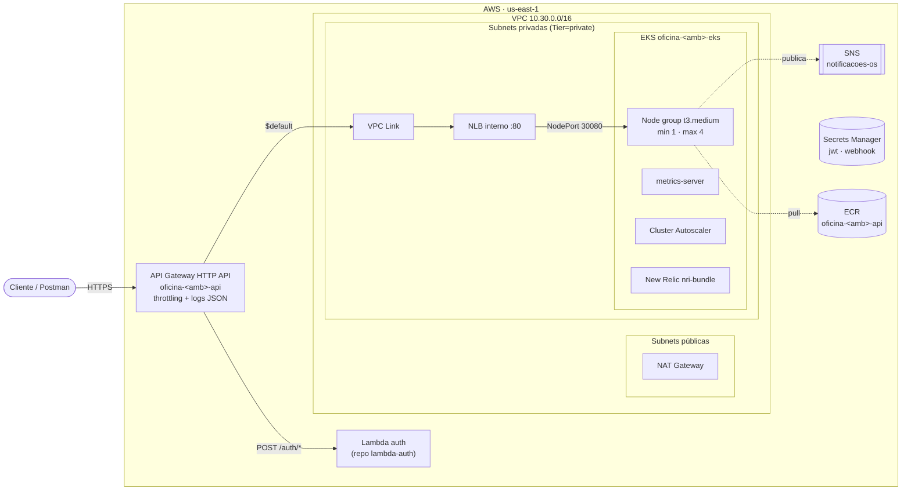

# oficina-infra-k8s

Infraestrutura de **rede, Kubernetes e entrada** da oficina na AWS, provisionada com Terraform: VPC, cluster EKS com autoscaling, API Gateway com rate limit, NLB interno, segredos compartilhados, tópico SNS de notificações, repositório de imagens (ECR) e integração com o New Relic.

Repositório 2 de 4 do Tech Challenge da Fase 3 (SOAT):

| Repositório | Conteúdo |
| --- | --- |
| oficina-lambda-auth | Lambdas de autenticação (CPF e funcionário) e job de inativação de clientes |
| **oficina-infra-k8s** (este) | VPC, EKS, API Gateway, NLB, segredos JWT e webhook, SNS, ECR, New Relic |
| oficina-infra-db | RDS PostgreSQL, security groups e segredo do banco |
| [tech-challenge-oficina-mecanica](https://github.com/menta2010/tech-challenge-oficina-mecanica) | API de ordens de serviço rodando no Kubernetes |

**Ordem de deploy:** **infra-k8s** → infra-db → lambda-auth → app. Este é o primeiro: os outros encontram a VPC, o cluster e o API Gateway pelos nomes `oficina-<ambiente>-*`.

## Links

| Item | Link |
| --- | --- |
| API publicada (prod) | https://7d2ypan7l9.execute-api.us-east-1.amazonaws.com |
| Swagger | https://7d2ypan7l9.execute-api.us-east-1.amazonaws.com/swagger |
| Collection Postman | [oficina-fase3.postman_collection.json](https://github.com/menta2010/tech-challenge-oficina-mecanica/blob/master/docs/postman/oficina-fase3.postman_collection.json) |

O ambiente roda no AWS Academy: a URL só responde enquanto o laboratório está ligado.

## Arquitetura deste repositório



## O que é provisionado

| Arquivo | Recursos |
| --- | --- |
| `vpc.tf` | VPC com 2 AZs, subnets públicas e privadas, 1 NAT Gateway e tags usadas pelos outros repositórios e pelo Kubernetes |
| `eks.tf` | Cluster EKS 1.31, node group gerenciado (t3.medium, mín. 1, desejado 2, máx. 4) e roles IAM (ou a `LabRole` do AWS Academy) |
| `gateway.tf` | NLB interno → NodePort 30080; API Gateway HTTP API com VPC Link, rota `$default` para a API, throttling global e nas rotas de autenticação, CORS e log de acesso em JSON |
| `shared.tf` | Segredos `oficina/<amb>/jwt` e `oficina/<amb>/webhook`, tópico SNS `oficina-<amb>-notificacoes-os` (+ assinatura por e-mail) e ECR com scan de vulnerabilidades |
| `addons.tf` | Helm: metrics-server (HPA), Cluster Autoscaler (nós) e New Relic `nri-bundle` (métricas de nós/pods, eventos, kube-state-metrics) |

## Escalabilidade e proteção

| Camada | Mecanismo |
| --- | --- |
| Entrada | **Rate limit no API Gateway**: 50 req/s sustentado e rajada de 100 no gateway inteiro; 5 req/s nas rotas `/auth/*` (aplicado pelo repo `oficina-lambda-auth`, dono dessas rotas). Acima disso o gateway responde **429** sem tocar no cluster |
| Pods | **HPA** da aplicação (CPU/memória, definido no repo `tech-challenge-oficina-mecanica`), lendo métricas do metrics-server |
| Nós | **Cluster Autoscaler**: quando o HPA cria pods que não cabem, o node group cresce até 4 nós e encolhe depois de 5 min ociosos |
| Balanceamento | NLB interno distribui entre todos os nós; o target group acompanha o autoscaling do node group |

## Tecnologias

Terraform 1.13 · AWS provider 5 · módulo `terraform-aws-modules/vpc` · Amazon EKS · Helm provider · API Gateway HTTP API · NLB · SNS · Secrets Manager · ECR · New Relic Kubernetes integration · GitHub Actions

## Executando

Pré-requisitos: AWS CLI autenticado, `kubectl`, bucket S3 para o estado.

```bash
terraform init -backend-config="bucket=<bucket-do-estado>" -backend-config="key=oficina/infra-k8s/homolog.tfstate" -backend-config="region=us-east-1"
terraform apply -var="environment=homolog" -var="notification_email=grupo@exemplo.com" -var="newrelic_license_key=<license-key>"
aws eks update-kubeconfig --name oficina-homolog-eks --region us-east-1
kubectl get nodes
```

No **AWS Academy (Learner Lab)**, que não permite criar roles IAM, informe a `LabRole`:

```bash
terraform apply -var="environment=homolog" -var="cluster_role_arn=arn:aws:iam::<conta>:role/LabRole" -var="node_role_arn=arn:aws:iam::<conta>:role/LabRole"
```

**Custo:** o EKS cobra por hora de cluster, e o NAT Gateway e os nós também. Destrua o ambiente quando não estiver demonstrando, na ordem inversa do deploy (app → lambda-auth → infra-db → infra-k8s):

```bash
terraform destroy -var="environment=homolog"
```

## CI/CD

| Evento | O que roda |
| --- | --- |
| Pull Request para `develop` ou `main` | `fmt`, `validate` e `plan` do ambiente de destino |
| Merge em `develop` | `apply` em **homolog** + verificação dos nós e do metrics-server |
| Merge em `main` | `apply` em **prod** |

Configuração no GitHub (uma vez):

1. Environments `homolog` e `prod`:
   - Secrets: `AWS_ACCESS_KEY_ID`, `AWS_SECRET_ACCESS_KEY`, `AWS_SESSION_TOKEN` (AWS Academy) e `NEW_RELIC_LICENSE_KEY`.
   - Variables: `TF_STATE_BUCKET`, `AWS_REGION`, `NOTIFICATION_EMAIL` e, no AWS Academy, `CLUSTER_ROLE_ARN` e `NODE_ROLE_ARN` com o ARN da `LabRole`.
2. Proteção das branches `main` e `develop`: Pull Request obrigatório, check `Terraform validate` obrigatório e push direto bloqueado.
3. Colaborador `soat-architecture` com acesso de leitura.

## Saídas

| Output | Uso |
| --- | --- |
| `api_endpoint` | URL base das APIs (Postman, vídeo, README dos outros repositórios) |
| `swagger_url` | Swagger da API publicada |
| `cluster_name` | `aws eks update-kubeconfig` |
| `ecr_repository_url` | Destino da imagem da API no pipeline do `tech-challenge-oficina-mecanica` |
| `sns_topic_arn` | Configuração `Notificacoes__SnsTopicArn` da API |
